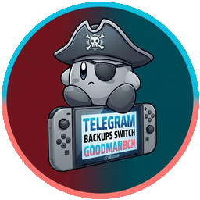

<div align="center">
  
  <h1>The Goonies Pack Builder</h1>
  <p><strong>Build Your Pack. Play Your Way.</strong></p>
  <p><em>Custom Pack Creator for Nintendo Switch</em></p>
  <p>
    <a href="#-español">🇪🇸 Español</a> •
    <a href="#-english">🇬🇧 English</a> •
    <a href="https://github.com/GoodmanBCN10/The-Goonies-OS-for-Switch">The Goonies OS</a>
  </p>
</div>

---

## 🇪🇸 Español

**Crea tu pack personalizado de The Goonies OS, selecciona tus aplicaciones homebrew favoritas e instálalo directamente en tu Nintendo Switch mediante USB.**

### ✨ Características Principales

- **Instalación Directa por USB (Hekate UMS):** Detecta automáticamente la tarjeta microSD de la consola conectada desde `Hekate -> Tools -> USB Tools -> SD Card` y permite expulsarla de forma segura desde la propia aplicación.
- **Instalación Limpia Protegida:** Limpia la raíz de la microSD antes de instalar el nuevo pack garantizando al **100% la preservación** de tus carpetas `emuMMC` y `Nintendo`.
- **Perfiles Rápidos (Presets):**
  - ⭐ **Recomendado:** Pack Base + *MissionControl*, *Nextendo*, *Quick Reboot*, *90DNS Setter* y *90DNS Tester*.
  - ⚡ **Mínimo:** Solo el Pack Base limpio (*The Goonies OS*).
  - 🔥 **Completo:** Todas las aplicaciones y herramientas del catálogo activadas.
- **Sincronización Automática con GitHub:** Consulta en segundo plano las últimas versiones (*releases*) de cada repositorio al iniciar la aplicación y selecciona siempre la versión más reciente por defecto.
- **Caché Inteligente y Segura:** Descarga y verifica todos los archivos en caché local antes de tocar la microSD. Distingue entre el tamaño ya en caché y el tamaño pendiente de descarga.
- **Detector de Compatibilidad de Firmware:** Avisa automáticamente si el firmware seleccionado supera la versión máxima soportada por la versión elegida del Pack Base.
- **Interfaz Bilingüe (`🇪🇸 ES` / `🇬🇧 EN`):** Cambio instantáneo entre Español e Inglés, incluyendo un **Glosario para principiantes** (*Atmosphere, Hekate, Daybreak, emuMMC, Sysmodules, Payloads*).

### 📦 Catálogo Integrado

| Componente | Repositorio Oficial | Descripción |
| :--- | :--- | :--- |
| **Pack Base** | [`GoodmanBCN10/The-Goonies-OS-for-Switch`](https://github.com/GoodmanBCN10/The-Goonies-OS-for-Switch) | Pack CFW completo con Atmosphere, Hekate y configuración optimizada |
| **Firmware** | [`GoodmanBCN10/NS_Firmware`](https://github.com/GoodmanBCN10/NS_Firmware) | Firmware oficial listo para instalar con Daybreak (`/Firmware X.Y.Z`) |
| **MissionControl** | [`ndeadly/MissionControl`](https://github.com/ndeadly/MissionControl) | Uso de mandos Bluetooth (PS4, PS5, Xbox, Wii U, etc.) de forma nativa |
| **Nextendo (Prelude)** | [`NextendoNetwork/Prelude-Nextendo`](https://github.com/NextendoNetwork/Prelude-Nextendo) | Cliente y servicios online alternativos para Nintendo Switch con emuMMC |
| **Quick Reboot** | [`eradicatinglove/Quick-Reboot`](https://github.com/eradicatinglove/Quick-Reboot) | Reinicio rápido a Hekate, payload CFW o apagado desde el Homebrew Menu u Overlay |
| **90DNS Setter** | [`suchmememanyskill/switch-90dns-setter`](https://github.com/suchmememanyskill/switch-90dns-setter) | Configuración automática de servidores 90DNS en todas las redes Wi-Fi guardadas |
| **90DNS Tester** | [`meganukebmp/Switch_90DNS_tester`](https://github.com/meganukebmp/Switch_90DNS_tester) | Verificación del bloqueo de dominios y servidores de Nintendo |
| **Sphaira** | [`ITotalJustice/sphaira`](https://github.com/ITotalJustice/sphaira) | Homebrew Menu avanzado con gestor de archivos y temas |
| **TICO** | [`ticohq/tico`](https://github.com/ticohq/tico) | Frontend de emulación personalizado para Nintendo Switch con tienda de módulos |
| **Ultrahand Overlay** | [`ppkantorski/Ultrahand-Overlay`](https://github.com/ppkantorski/Ultrahand-Overlay) | Menú overlay personalizable en partida |
| **sys-clk** | [`ppkantorski/sys-clk`](https://github.com/ppkantorski/sys-clk) | Sysmodule y overlay (`libultrahand`) de overclock/underclock de CPU, GPU y RAM |
| **Fizeau** | [`averne/Fizeau`](https://github.com/averne/Fizeau) | Gestión de color, temperatura, contraste y filtro de luz azul en pantalla |
| **SysDVR** | [`exelix11/SysDVR`](https://github.com/exelix11/SysDVR) | Streaming de vídeo y audio de juegos al PC o móvil por USB o red |
| **Switch Frame Tap** | [`TomasUribe/switch-frame-tap`](https://github.com/TomasUribe/switch-frame-tap) | Streaming a 1080p60 con sonido por USB-C o red, grabación MP4 y capturas nativas |
| **JKSV** | [`J-D-K/JKSV`](https://github.com/J-D-K/JKSV) | Gestor de partidas guardadas (saves) |
| **Linkalho** | [`impeeza/linkalho`](https://github.com/impeeza/linkalho) | Vinculación offline de cuentas Nintendo |
| **DBI (Ruso)** | [`rashevskyv/dbi`](https://github.com/rashevskyv/dbi) | Última versión oficial en ruso (si no se marca, se conserva DBI en español del Pack Base) |
| **Lockpick RCM Pro** | [`sthetix/Lockpick_RCM_Pro`](https://github.com/sthetix/Lockpick_RCM_Pro) | Payload para volcar claves (`prod.keys` / `title.keys`) desde Hekate |

### 🚀 Uso de la Aplicación

1. Descarga el ejecutable desde la sección de [**Releases**](https://github.com/GoodmanBCN10/The-Goonies-Pack-Builder/releases).
2. En tu Nintendo Switch, entra en **Hekate** y abre `Tools -> USB Tools -> SD Card`, luego conecta la consola al PC por USB.
3. Abre **Goonies Pack Builder**, selecciona la unidad microSD detectada, elige tu perfil o personaliza tus aplicaciones y pulsa **🚀 Instalar en Nintendo Switch**.
4. Al finalizar, pulsa **⏏️ Desconectar Consola** para expulsar la unidad de forma segura.

### 🛠️ Ejecutar o Compilar desde el Código Fuente

```bash
# Instalar dependencias
pip install -r requirements.txt

# Ejecutar en modo escritorio
python app.py

# Compilar ejecutable independiente (.exe)
Compilar_EXE.bat
```

---

## 🇬🇧 English

**Create your custom The Goonies OS pack, select your favorite homebrew apps and install it directly onto your Nintendo Switch via USB.**

### ✨ Key Features

- **Direct USB Installation (Hekate UMS):** Automatically detects your Switch microSD connected via `Hekate -> Tools -> USB Tools -> SD Card` and includes a safe console eject button.
- **Protected Clean Install:** Cleans the microSD root prior to installing the new pack while **100% preserving** your `emuMMC` and `Nintendo` folders.
- **Quick Presets:**
  - ⭐ **Recommended:** Base Pack + *MissionControl*, *Nextendo*, *Quick Reboot*, *90DNS Setter*, and *90DNS Tester*.
  - ⚡ **Minimal:** Clean Base Pack only (*The Goonies OS*).
  - 🔥 **Full:** Every app and tool in the catalog enabled.
- **Automatic GitHub Sync:** Fetches the latest GitHub releases in the background on startup and automatically selects the newest version by default.
- **Smart Local Cache:** Downloads and validates all release assets into a local cache before touching the microSD, displaying cached size vs. remaining download size.
- **Firmware Compatibility Check:** Warns you if the selected firmware exceeds the maximum version supported by the chosen Base Pack release.
- **Bilingual UI (`🇪🇸 ES` / `🇬🇧 EN`):** Instant language switching between Spanish and English, plus a built-in **Beginner's Glossary** (*Atmosphere, Hekate, Daybreak, emuMMC, Sysmodules, Payloads*).
